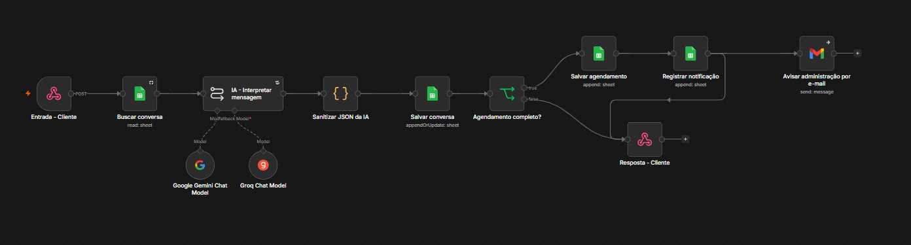
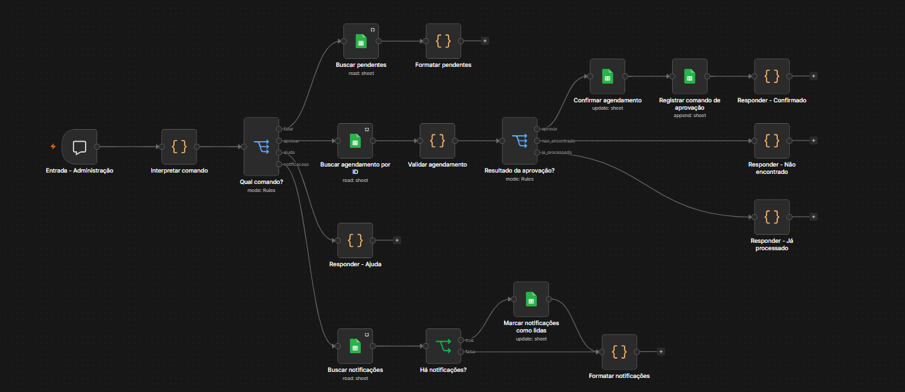
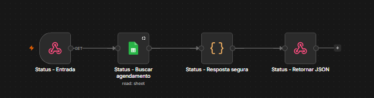

# Atendimento e agendamento veterinário com n8n

Projeto acadêmico que automatiza a coleta de dados para agendamentos veterinários. O cliente faz o pedido pelo chat web, e a equipe consulta e confirma os pedidos em uma área administrativa com login do n8n.

## Como funciona

1. O chat envia a mensagem e o identificador da sessão ao n8n por um webhook HTTP. O fluxo recupera o histórico da sessão no Google Sheets e usa o Gemini para interpretar a mensagem, com o Groq como alternativa em caso de falha.
2. O workflow valida em JavaScript os campos extraídos e as datas. Quando falta algum dado, o chat pede a informação e guarda o que já recebeu para a próxima mensagem.
3. Com os campos completos, o n8n registra o pedido como **Pendente** no Google Sheets e avisa a administração pelo Gmail.
4. A equipe consulta os pedidos e confirma cada um pelo chat administrativo. O cliente acompanha o status pelo número do pedido.

~~~mermaid
flowchart LR
    Cliente[Chat do cliente] --> Atendimento[Webhook no n8n]
    Atendimento --> IA[Gemini com fallback para Groq]
    IA --> Validacao[Validação em JavaScript]
    Validacao --> Planilha[(Google Sheets)]
    Validacao -->|Novo pedido| Gmail[Aviso por Gmail]
    Admin[Chat administrativo] -->|Confirmação| Planilha
    Planilha -->|Status do pedido| Cliente
~~~

O [workflow do n8n](workflows/clinica-veterinaria.json) contém o atendimento, a consulta de status e os comandos da administração. A pasta [chat_cliente](chat_cliente/) contém as páginas HTML e o servidor Node.js que encaminha as chamadas ao n8n. O servidor usa apenas módulos nativos do Node.js.

## Partes do workflow

### 1. Atendimento ao cliente

O webhook recebe a mensagem e busca a conversa pelo identificador da sessão. O Gemini extrai os dados do pedido em JSON, com o Groq como alternativa se o modelo principal falhar. Um nó JavaScript valida os campos e a data, e o fluxo salva o contexto da conversa no Google Sheets.

Se falta algum dado, o chat pede a informação para continuar na próxima mensagem. Quando o pedido está completo, o fluxo registra o agendamento como **Pendente**, devolve o número do pedido ao cliente e avisa a equipe pelo Gmail.

### 2. Administração dos agendamentos

O chat usa o login do n8n e encaminha cada comando para a operação correspondente. `/listar pendentes` mostra os pedidos aguardando confirmação. `/notificacoes` exibe os avisos e os marca como lidos. `/ajuda` apresenta os comandos disponíveis.

Ao receber `/aprovar ID`, o fluxo busca o pedido pelo número. Se estiver **Pendente**, muda o status para **Confirmado** e registra a aprovação na aba `Comandos`. Se o pedido não existir ou já tiver sido processado, o chat informa o resultado.

### 3. Consulta de status pelo cliente

O chat consulta um webhook `GET` com o número do pedido. O n8n busca o registro no Google Sheets e devolve um JSON com três campos: número, status e indicador de confirmação. Os possíveis status são **Pendente**, **Confirmado** e **Desconhecido**.

## Rodar localmente

Você precisa de Node.js 22 ou superior, Docker, uma planilha no Google Sheets e credenciais próprias para Google Sheets, Gmail, Gemini e Groq.

### 1. Inicie o n8n

~~~sh
docker run --rm --name n8n-clinica-demo -p 127.0.0.1:5678:5678 -v clinica_n8n_data:/home/node/.n8n -e GENERIC_TIMEZONE=America/Sao_Paulo -e TZ=America/Sao_Paulo -e N8N_SECURE_COOKIE=false docker.n8n.io/n8nio/n8n
~~~

Abra **http://localhost:5678** e crie a conta local no primeiro acesso. A configuração de cookie acima se aplica à demonstração HTTP em loopback. [Instalação com Docker](https://docs.n8n.io/hosting/installation/docker/)

### 2. Configure a planilha e importe o workflow

Crie uma planilha com estas três abas. Cole os nomes das colunas na primeira linha, em células separadas.

| Aba | Colunas |
| --- | --- |
| `Conversas` | `sessao_id`, `historico`, `dados_parciais`, `ultima_pergunta`, `atualizado_em`, `concluida` |
| `Agendamentos` | `id`, `criado_em`, `nome_tutor`, `telefone`, `nome_pet`, `especie`, `servico_desejado`, `data_hora_sugerida`, `resumo_conversa`, `status` |
| `Comandos` | `id_comando`, `recebido_em`, `comando`, `status_processamento`, `resposta`, `processado_em` |

1. Abra um workflow no editor do n8n e importe [clinica-veterinaria.json](workflows/clinica-veterinaria.json) pelo menu **Import from File**.
2. Nos nós do Google Sheets, selecione uma credencial de conta de serviço, informe o ID da planilha e confira a aba indicada. Compartilhe a planilha com o e-mail da conta de serviço com permissão de edição.
3. Conecte as credenciais do Gemini, do Groq e do Gmail. Confira os modelos disponíveis nas suas contas e configure o endereço de destino no nó **Avisar administração por e-mail**.
4. Mantenha **n8n User Auth** no nó **Entrada - Administração**. Publique o workflow e copie o trecho `/webhook/<id>/chat` do endereço mostrado em **Chat URL**. [Importação de workflows](https://docs.n8n.io/workflows/export-import/) · [Chat Trigger](https://docs.n8n.io/integrations/builtin/core-nodes/n8n-nodes-langchain.chattrigger/)

### 3. Inicie o chat

Na raiz do repositório, use o caminho copiado do n8n.

~~~powershell
$env:ADMIN_CHAT_PATH = '/webhook/ID_DO_SEU_CHAT/chat'
node chat_cliente/server.js
~~~

No Bash, execute:

~~~sh
ADMIN_CHAT_PATH='/webhook/ID_DO_SEU_CHAT/chat' node chat_cliente/server.js
~~~

O chat do cliente fica em **http://localhost:8080**. A área administrativa fica em **http://localhost:8080/admin** e solicita o login da sua instância. Use `PORT` ou `N8N_URL` se precisar mudar a porta do chat ou o endereço HTTP local do n8n.

## Demonstração

1. Abra o chat do cliente e peça uma consulta usando nome, telefone e dados do pet fictícios. Deixe um campo faltando de propósito e responda à pergunta do chat. Use uma data futura.
2. Anote o número do pedido e confira o status **Pendente** na aba **Agendamentos**. A administração recebe o aviso cadastrado no Gmail.
3. Entre na área administrativa e use `/listar pendentes`, `/notificacoes` e `/aprovar ID`, substituindo `ID` pelo número recebido. `/ajuda` lista os comandos.
4. Consulte o mesmo número no chat do cliente e confira o status **Confirmado**.
